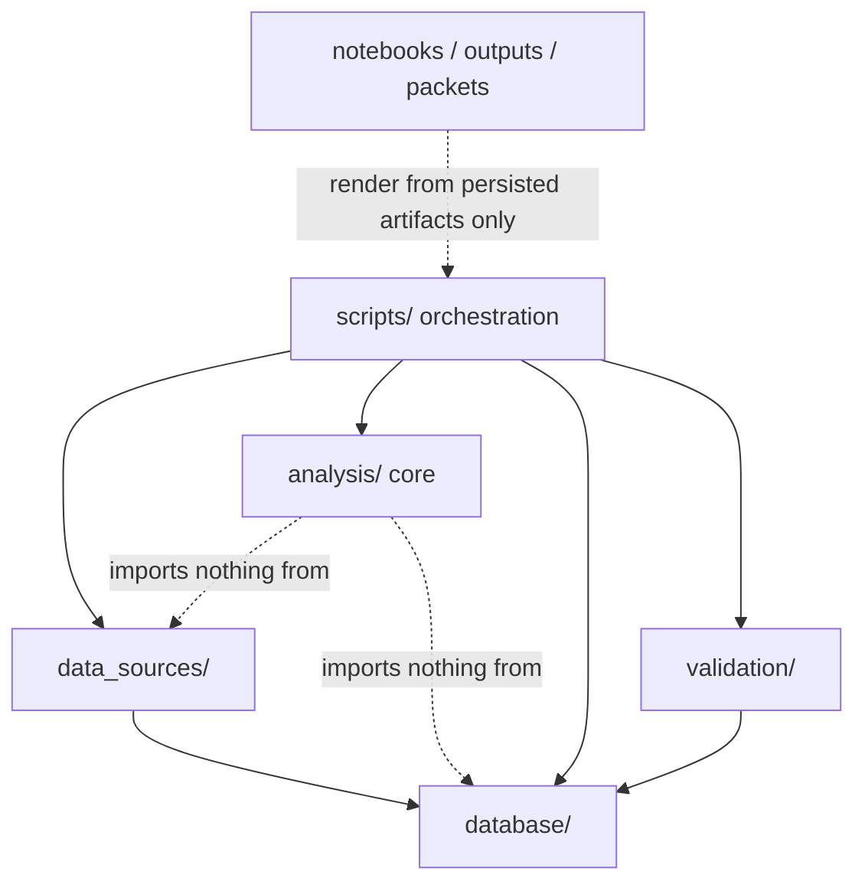
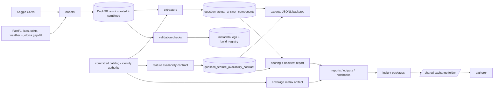

# Architecture Spine — f1_analytics questions-analysis rebuild

## Design Paradigm

**Layered batch pipeline** over a single local DuckDB store, with a **pragmatic functional-core / imperative-shell** split inside the package:

| Layer | Lives in | Role |
| --- | --- | --- |
| Ingestion shell | `src/f1_analytics/data_sources/` | Kaggle/FastF1 loaders; cache-then-parse; all source IO; maps every source into the shared entity id space (AD-14) |
| Storage edge | `src/f1_analytics/database/` | The only module that opens DuckDB connections; owns all `question_*` DDL and the two write helpers (AD-4) |
| Analysis core | `src/f1_analytics/analysis/` | Catalog loading, extractors, coverage, scoring, reporting logic; importable functions; no HTTP, no direct file/DB IO |
| Build validation | `src/f1_analytics/validation/` | Advisory post-build checks (null rates, referential integrity); reads via `database/`, logs to `validation_results`, never halts a build |
| Orchestration shell | `scripts/*.py` | Thin entry points that wire storage → core → storage/outputs |
| Consumers | `notebooks/`, `outputs/`, exchange packets | Render from persisted tables/artifacts only; never compute or hold authoritative state |

*Pragmatic* means: the core stays IO-free and its data conditions surface as statused values, but full ceremony (frozen dataclasses everywhere, validation-only-as-returned-data) is not mandated — use it where re-run reproducibility or controlled vocabularies demand it, plain Python elsewhere.

## Invariants & Rules



Dependency direction is a rule: `analysis/` never imports `data_sources/`, `database/`, `validation/`, or `scripts/`; nothing imports `scripts/`.

### AD-1 — Single local DuckDB store; committed sources of truth `[ADOPTED]`

- **Binds:** all
- **Prevents:** parallel stores diverging; infrastructure creep; unreproducible state
- **Rule:** All durable tabular state lives in `data/processed/f1_analytics.duckdb`. No server database, no second store, no hosted service (NFR-5). Disposability is scoped by table class: **ingestion tables** are derived and rebuildable from committed code plus raw caches; **target-store and metadata tables** are history whose committed backstop is the per-run export (AD-4). The Question Catalog — including every `user_manual_approved` promotion, which is a recorded user decision — is a committed artifact (AD-15); its DuckDB projection is a derived copy (PRD §9, NFR-1).

### AD-2 — Source precedence rule, with a single arbiter `[ADOPTED]`

- **Binds:** results/standings/qualifying facts (facts with a Kaggle counterpart); combined tables
- **Prevents:** two units resolving Kaggle/Jolpica conflicts differently, or at different edges
- **Rule:** Kaggle wins any season/round where it has ≥1 results row; Jolpica-sourced rows fill only zero-row season/rounds; a `row_count_diverges` season/round keeps Kaggle rows and MUST surface as a documented deviation in the consuming output — never silently resolved. The `kaggle_jolpica_coverage` view is the **single arbiter**: consumers read its status tags (`match | kaggle_only | jolpica_only | row_count_diverges | no_data`), they never recompute the comparison. **Scope carve-out:** lap timing, tyre/stint, and weather facts have no Kaggle counterpart and come from FastF1 under AD-6 — precedence does not apply to them.

### AD-3 — Controlled vocabularies, each defined once `[ADOPTED]`

- **Binds:** catalog, target store, coverage matrix, feature contract, all report surfaces, badges
- **Prevents:** divergent per-module enums; unrenderable or unauditable states
- **Rule:** Five closed vocabularies, each defined in exactly one place and imported everywhere:
  1. **Answer status** — `pending | computed | partial | source_blocked | discrepant_needs_review | premise_incorrect | user_manual_option | user_manual_approved`. `user_manual_*` promotion is a user decision, never an AI default (PRD §6). `premise_incorrect` requires an eighth status-badge token added to `DESIGN.md` frontmatter (recorded UX delta).
  2. **Coverage availability** (FR-10) — `available | derivable | user_manual_option | new_source_required | paid_source_required | out_of_scope`. Gate: no downstream tyre/scoring feature is marked ready while a required fact's coverage is unknown.
  3. **Feature availability** (FR-15) — `already_available | derivable_from_current_tables | requires_new_source | user_supplied | out_of_scope`.
  4. **Feature groups** (FR-15) — `results_form | qualifying_form | track_history | driver_history | constructor_performance | pit_tyre_tendencies | weather_session_conditions | source_freshness`; the coverage matrix's fact keys and the feature contract's groups both draw from catalog-declared identities (AD-15), never ad-hoc strings.
  5. **Source-coverage tags** — owned by the `kaggle_jolpica_coverage` view (see AD-2).
  These are **internal** vocabularies; exchange packets use the packet-standing vocabulary in AD-9 and never emit these values. Status rendering: one module owns the status→token mapping; `DESIGN.md` frontmatter is the token authority; status is always text plus color, never color alone; the enumerated badge pairs meet WCAG 2.2 AA contrast.

### AD-4 — Write-pattern split by table class, enforced at the storage edge `[ADOPTED]`

- **Binds:** every DuckDB write
- **Prevents:** discrepancy history destroyed by replace-in-place; mixed write semantics; unordered or torn builds
- **Rule:** Three table classes with three write patterns:
  1. **Ingestion** (`raw_*`, curated, `combined_*`) — idempotent `CREATE OR REPLACE` sync of the source.
  2. **Target store** (`question_actual_answer_components`, key `(question_id, component_key, build_id)`; `question_feature_availability_contract`, key `(question_id, feature_group, build_id)`) — append-only via `CREATE TABLE IF NOT EXISTS` + `INSERT`; a re-run adds rows under a new `build_id`, never updates or deletes.
  3. **Per-build metadata** (`build_registry`, `source_registry`, `source_load_log`, `validation_results`) — append-per-build log rows.
  **Builds:** one `build_id` per orchestration run, spanning BOTH target tables — format `{UTC yyyymmddThhmmssZ}-{producer_run_id}`. Every run appends a `build_registry` row (`build_id`, analysis mode, started/finished, `complete | failed`); "latest" is always resolved through the registry, never by string-sorting `build_id`s. A failed run's rows stay but its build is never `complete`, so no consumer sees them (AD-5).
  **Enforcement:** `database/` owns all `question_*` DDL (lap/position columns typed `INTEGER`) and exposes exactly two writers: the replace helper **rejects** `question_*` targets; the typed append helper (which rejects unknown or mistyped columns) is the only writer for them.
  **Committed backstop:** every completed build's target-store rows are also appended to a git-tracked JSONL export under `exports/` — the history survives loss of the gitignored store (this is the PRD §9 "later decision" that changes artifact tracking for exactly these rows).
  Views live in `sql/` and are not writes. The tyre/pit **coverage matrix is a generated report artifact** (`outputs/`), not a DuckDB table.

### AD-5 — Consumers read one complete build `[ADOPTED]`

- **Binds:** scoring, backtest report, workflow/report surfaces, insight-package producer
- **Prevents:** the prior wiring gap; chimera answer sets stitched across builds or modes
- **Rule:** One orchestration script runs extractors over catalog rows and writes the target store. Every downstream consumer reads from the persisted tables — never from caller-supplied in-memory rows — and reads exactly **one build**: the latest `complete` build in the requested analysis mode, per the `build_registry`. Per-key maxima across builds are forbidden. Every report, package, and aggregate cites the single `build_id` it was rendered from. The discrepancy surface is the sole consumer permitted to read across builds. Verification evidence (e.g. the 2026-07-28 OpenF1-verified Q05 compound) enters as a **cited fact** inside a statused record, never as a data row a consumer reads. "Not yet computed" is a rendered status, not an accepted end state.

### AD-6 — Ingestion source roles; no new source without a decision record `[ADOPTED]`

- **Binds:** `data_sources/`, coverage matrix, every extractor
- **Prevents:** silent source mixing; source sprawl; rebuilding lost pagination code
- **Rule:** Source roles are fixed: **Kaggle** — authoritative results/curated tables (AD-2). **FastF1** (adopted 2026-08-06) — lap timing, tyre/stint, and weather facts, plus Ergast-compatible Jolpica access for current-season results gap-fill. **OpenF1** — retired; not rebuilt; its one verified fact (Q05 compound=MEDIUM, session_key=11326) remains citable evidence. FastF1 binds only after its gate: a pandas-3.0 compatibility spike plus a PRD §9 source decision record (access model, cost, license/terms risk, authentication, maintenance burden). **Any** new source — free or paid — requires that same five-field decision record before code depends on it (PRD §9; NFR-6).

### AD-7 — Leakage boundary is enforced at the core; mode is a run parameter `[ADOPTED]`

- **Binds:** catalog, feature contract, baselines (FR-3, FR-14..16, NFR-4)
- **Prevents:** post-race facts leaking into pre-race features; catalog rows duplicated per mode
- **Rule:** Analysis Mode (`pre_race | post_race`) is a **run-level parameter** recorded on the build (AD-4 registry) and on outputs — catalog rows are mode-agnostic and are never duplicated to represent modes (FR-3). Every question defines its feature-snapshot boundary in the catalog. Post-race fact groups are forbidden inputs for pre-race features, enforced by the feature-availability contract — not by each consumer's discretion. Baselines are generated only against a leakage-safe snapshot or marked unavailable-with-reason.

### AD-8 — Publication gating derives from status, provenance, and identity `[ADOPTED]`

- **Binds:** report surfaces, portfolio summary, insight packages, scoring
- **Prevents:** the recorded wrong-output classes (DW-92/94/112/32): overclaims from the surface built to catch overclaims
- **Rule:** `portfolio_ready` (and any publication flag) derives from validation status AND the analysis-mode boundary — never from an answer merely existing. Any prediction↔actual pairing asserts **`(question_id, component_key)`** equality before scoring. Computed-source success counts exclude `user_manual_approved` rows; provenance travels with every aggregate (SM-C3). Lap numbers and positions are integers end-to-end (typed `INTEGER` at the storage edge, AD-4); a numeric comparison that could see float promotion normalizes types first. Prediction-wrong is always distinguished from actual-unscoreable. Build validation (`validation/`) is advisory-and-logged; gating happens only at publication, from recorded status.

### AD-9 — Gatherer interchange: one channel, conforming packets `[ADOPTED]`

- **Binds:** insight-package producer, all cross-project communication
- **Prevents:** undelivered packets; mechanically-rejected packets; silent partial corrections
- **Rule:** The shared exchange folder `/Users/antonio/howdoidata/projects/exchange/` is the ENTIRE channel (verified on disk 2026-08-06; the folder README's own §1 path is stale — raise via the channel, never create a second folder). No direct cross-repo reads or writes in either direction; `observable_paths.f1` = `[]`, permanently. The payload contract is gatherer's `HS-f1-gatherer` **v2**, learned only through channel packets (authority packet: `gatherer-handoff-spec-item-set-declaration-2026-07-30.md`); re-check the pin on any new declaration packet. A delivered packet is immutable — never edited, deleted, or renamed; `body_sha256` over one's own body is f1's only mechanical proof of non-mutation.
  - **Filename** (f1-owned convention): `f1-{slug}-{YYYY-MM-DD}[b..g].md` — prefix is the project token `f1`, not the `from:` value. A filename is never an ordering or disposition signal and must not contradict the packet's own content.
  - **Envelope frontmatter:** `from`, `to`, `date` (date in the authoring zone), `authored_at` (`YYYY-MM-DDTHH:MM:SS±HH:MM`, authoring offset — never UTC-normalized; the ordering key, never file mtime), `thread`, relation fields (`responds_to`/`corrects`/`supersedes`/`supplements` — **frontmatter only; prose supersession is void**), `body_sha256`, `packet_class`. Quotations of other packets carry a version stamp. `to:` governs standing: content is not reasoned from unless f1 is addressed.
  - **Class selection:** `evidence_delivery` — new or *changed* evidence at a declared handoff level (changed evidence is a NEW evidence_delivery; a correction cannot reopen a settled item). `correction` — erratum, disposition-only reply, or chain closure; declares its relations in frontmatter naming every overridden packet, carries an explicit authority statement, and makes a **total restatement of the item set owned by the receiver's spec** (14 items for Q05) — one row per item: item, current value, standing (matching the authority packet's three-column form; `[ASSUMPTION]` spec prose also names a sourcing-packet reference — confirm when authoring the in-repo companion). `intake` — asserts nothing about the counterparty, opens its own thread, exempt from restatement.
  - **Packet-standing vocabulary** (restatement rows only): `source_backed | [ASSUMPTION] | explicitly_out_of_scope | waiting_on_input | current` (the authority packet's own restatement uses `current` for items 12–14). AD-3 statuses are internal and never emitted into packets (`source_blocked` maps to `waiting_on_input`).
  - **Evidence-delivery required properties**, by v2 key names: `source_scope` (`user_provided` when exchange-staged), `authorization` (silence is not authorization), `portfolio_status`, `analysis_status`, `decision_question`, `evidence_refs` (labels vs direct-read paths stated), `findings` (facts separated from unresolved discrepancies), `assumptions`, `known_gaps`, `handoff_level`, `producer_run_id`. Package ID = `{question_id}:{producer_run_id}`.

### AD-10 — Rebuild is contract-free; nothing is presumed done `[ADOPTED]`

- **Binds:** all rebuild epics/stories
- **Prevents:** one builder replicating lost-module contracts while another redesigns
- **Rule:** Prior module APIs (lost or surviving) do not bind the rebuild — surviving modules are salvage to adapt or replace, not fixed points. This **explicitly supersedes** the reconstruction doc's §5-step-4 framing ("intact modules pin the exact symbol contracts"); those modules are demoted to reference material. Prior completion claims are unverified; a capability exists only when this rebuild's tests prove it.

### AD-11 — The invocation convention lives in the repo; tests run offline `[ADOPTED]`

- **Binds:** all
- **Prevents:** the lost-convention trap; tests burning API budgets or flaking on live sources
- **Rule:** `pyproject.toml` with src layout and an editable install; pytest is the runner; every script runs via a documented `uv run` entry. If a command isn't runnable from a fresh clone **plus documented local credentials** using only committed files, it doesn't exist. Credential requirements are named per source: Kaggle needs the local token file; FastF1 and Jolpica need none. **Tests never touch the network**: loaders are tested against recorded fixtures cut from cached payloads; a network call inside pytest is a defect. Live-API verification happens only in explicitly named spike scripts.

### AD-12 — Seed answers never become targets; disagreement defaults to review `[ADOPTED]`

- **Binds:** catalog, extractors, target store, reports
- **Prevents:** the Q04 failure class (a bridge rendering an unreviewed value as final); PDF answers laundered into "computed" success
- **Rule:** Known Answer Examples are reconciliation evidence only — they never seed the target store. The only write paths into the target store are source-backed extraction or an explicit `user_manual_approved` promotion **recorded in the committed catalog** (AD-15). When a source-backed value disagrees with a Known Answer Example, the component's status is `discrepant_needs_review` — no value is auto-picked. (PRD OQ2 defers only *which override policy* may later be permitted, not this default.) When extraction proves a question's **premise** factually false (the asked-about event, state, or participation did not occur), the component's status is `premise_incorrect` — never scored as a wrong prediction — and the row records `premise_finding` (the failed premise with source evidence) and `corrected_answer` (the answer under the corrected premise), so the correct fact is captured as data. Components may declare checkable premises in the catalog (AD-15); extractors verify them before computing (AD-16).

### AD-13 — Ingestion completeness, caching, and rate discipline `[ADOPTED]`

- **Binds:** every loader
- **Prevents:** the Jolpica pagination class of defect (a silently shorter table); the prior runs' rate-limit error storms; un-replayable ingestion
- **Rule:** Loaders exhaust pagination and verify completeness against the source's own total where it publishes one; a truncated fetch is a statused failure, never a shorter table. Cache-then-parse: raw payloads land under `data/raw/<source>/...` before parsing; re-parsing never re-hits the network — a re-run serves everything cacheable from cache. Rate discipline:
  - Each client encodes its source's published limits as named constants beside the client, verified at implementation time. Jolpica (verified 2026-08-06): **4 req/sec burst, 500 req/hour sustained**, HTTP 429 "Request was throttled" on exceed — and jolpica states limits **will decrease**, so treat them as ceilings, throttle below them, and budget a whole ingestion run against the hourly cap before starting it.
  - FastF1's internal rate limiter (soft throttle, then `RateLimitExceededError`) is trusted; upstream enables its cache by default, and this project makes it **mandatory** — cached requests don't count against limits. Its managed cache lives at `data/raw/fastf1_cache/`.
  - On 429/5xx: bounded exponential backoff with a retry cap; on exhaustion the fetch becomes a statused failure — never a silent skip, never a hot retry loop.
  - Prefer bulk/filtered queries over per-round request loops wherever the API offers them.
  Surviving post-pagination-fix cache files (the 7 live Jolpica JSONs) win over any snapshot restore.

### AD-14 — One entity id space `[ADOPTED]`

- **Binds:** every loader, every join
- **Prevents:** per-source id schemes; joins keyed on unstable identifiers
- **Rule:** All sources resolve to the Ergast/Jolpica-style id space (`driver_id`, `constructor_id`) at the loader boundary — Kaggle≡Jolpica ids are row-level verified; FastF1 rows must be mapped on entry (by name-derived id, never by car number). Exactly one sanctioned name→id reconciliation exists (`final_driver_standings.constructor_id`); adding another requires a decision record.

### AD-15 — The committed catalog owns question and component identity

- **Binds:** catalog, extractors, target store, scoring, packages
- **Prevents:** two committed catalogs; extractor-invented component keys; mispaired scoring
- **Rule:** The Question Catalog is **one tracked YAML file** (`catalog/question_catalog.yaml`) validated by a loader in `analysis/`. Required fields per row: `question_id`, `season`, `grand_prix`, `session_context`, `team_scope`, `driver_scope` (nullable), `prompt`, `answer_type`, `source_artifact_path`, `known_answer_example`, `analysis_boundary`, and `components[]` — each component carrying `component_key`, `kind`, and unit/tolerance metadata where numeric. The catalog **mints every `component_key`** and declares the fact/feature-group identities the coverage matrix and feature contract consume (AD-3 #4); extractors, scorers, and packagers consume identities, never invent them. `user_manual_approved` promotions are recorded here. Schema extension is by data, not migration (NFR-7).

### AD-16 — Fail early: premises verified before work, everywhere

- **Binds:** all layers, all stories
- **Prevents:** computation proceeding on a false assumption and surfacing garbage late; the Q05-class late discovery
- **Rule:** Every unit verifies its preconditions BEFORE doing its work, and a failed precondition halts that unit immediately with an explicit finding — never partial output on an unverified premise. The finding's form is layer-appropriate: in `analysis/`, a statused value (question premises: `premise_incorrect` with `premise_finding` + `corrected_answer` per AD-12; catalog schema violations: named loader rejection per AD-15); in shells, a named fast failure (AD-13 prerequisites and completeness); at the storage edge, typed rejection (AD-4); at scoring, the pairing assertion (AD-8); at the exchange boundary, every outbound packet self-checks conformance against AD-9's contract before delivery — a non-conforming packet is never sent. Where the true state is determinable at failure time, the finding records the corrected fact — the `corrected_answer` parameter, generalized. **At the intake boundary** (user-supplied question batches), validation is a named check class — schema, entity resolution against known drivers/teams/races, arithmetic consistency of expected answers, range/sanity checks — and an UNAMBIGUOUSLY determinable input error is auto-corrected: the correction is applied, the original is preserved verbatim, and the correction is recorded and surfaced for review — never silent. Ambiguous errors halt with options presented.

## Standing Constraints

From the damage record (`repository-damage-and-recovery-options-2026-08-01.md`) — binding on every story until lifted:

- Never run `git gc`, `git prune`, or `git repack` in this repo (231 broken objects); never blanket `git restore .`.
- `/Users/antonio/dev/howdoidata/` is a structure-only skeleton — never a restore source.
- The platform snapshot's data (`recovery/platform-external-f1_analytics-snapshot-2026-07-09.tar.gz`) is pre-pagination-fix: live cache files win; its July-9 DuckDB is disposable scaffolding, never truth.
- Narrative/storytelling belongs to the ecosystem level (2026-07-24 reframing), not this project's outputs.

## Consistency Conventions

| Concern | Convention |
| --- | --- |
| Naming | snake_case modules; question IDs `{year}_{source}_{qnn}_{slug}` (e.g. `2026_pdf_q05_british_albon_start_tyre_and_first_change`); Package ID `{question_id}:{producer_run_id}`; DuckDB table classes `raw_*` / bare curated / `combined_*` / `question_*` / metadata logs; views live in `sql/`; generated surfaces use `DESIGN.md` §Components names **verbatim** (canonical inventory; no synonyms); packets per AD-9 |
| Data & formats | Internal timestamps UTC ISO-8601; packet timestamps per AD-9 (authoring zone); lap numbers and positions `int` end-to-end; statuses only from AD-3's vocabularies (internal) or AD-9's (packets); inferences marked `[ASSUMPTION]`; every Actual Answer Component cites source table/file, method, and `build_id` (NFR-2); catalog/target-store schema absorbs new answer types by data, not migration (NFR-7, SM-8) |
| State & cross-cutting | No module-level mutable state in `analysis/`; in `analysis/`, missing/ambiguous/conflicting source **content** becomes an explicit statused value, not an exception (NFR-3) — `data_sources/` and `scripts/` fail fast on missing prerequisites and ambiguous source **identity**; shared derived logic is computed by one function, never re-implemented per table (e.g. cumulative standings); no betting/odds/gambling/wagering framing in any generated text; no paid sources without a decision record (NFR-6) |
| Generated output | Every report surface follows the order: question answered → source and cutoff basis → answer + status → supporting table/figure → limitation and next action. Limitations and AD-2 deviations render **near the answer**, never buried at the end |

## Stack

| Name | Version |
| --- | --- |
| Python | 3.13 (3.13.7 local, verified 2026-08-06; deliberate pin below current 3.14 — matches gatherer, mature wheels for pandas 3/DuckDB; revisit at the ingestion epic) |
| uv (env + lock) | 0.12.x (0.12.2 verified 2026-08-06; 0.12.0 changed `uv init` build-system defaults and lockfile validation — set up against 0.12 docs, not memory) |
| DuckDB | 1.5.x (1.5.5 verified 2026-08-06) |
| pandas | 3.0.x (3.0.5 verified 2026-08-06; behavior changes vs the lost 2.x-era code) |
| FastF1 | 3.8.x (3.8.3 verified 2026-08-06; pandas-3 compat spike gates adoption, AD-6) |
| Plotly | 6.x (6.9.0 verified 2026-08-06; figures) |
| pytest | 9.x (9.1.1 verified 2026-08-06) |

## Structural Seed

```text
f1_analytics/
  pyproject.toml            # src layout, editable install, pytest config
  catalog/
    question_catalog.yaml   # committed catalog — the identity authority (AD-15)
  src/f1_analytics/
    data_sources/           # kaggle/fastf1 loaders; cache-then-parse; id mapping
    database/               # duckdb helpers; question_* DDL; the two writers (AD-4)
    analysis/               # catalog loader, extractors, coverage, scoring, reports
    validation/             # advisory post-build checks -> validation_results
  scripts/                  # thin uv-run entry points, one per pipeline stage
  sql/                      # view definitions (kaggle_jolpica_coverage, ...)
  notebooks/                # narrative rendering from persisted artifacts only
  exports/                  # git-tracked JSONL backstop of target-store appends (AD-4)
  data/raw/                 # gitignored source caches (incl. fastf1_cache/)
  data/processed/           # f1_analytics.duckdb (gitignored, derived)
  outputs/                  # generated reports/tables/figures (gitignored)
  tests/                    # offline; recorded fixtures only (AD-11)
```



**Operational envelope (decided, not deferred):** local macOS, single user; every pipeline stage is a manually invoked `uv run` script; no scheduler, no daily pipeline, no run-record layer, no CI obligation, no deployment target. Dropped by user decision 2026-08-06 — this supersedes the accepted `daily-pipeline-run-record-contract-decision-record.md` (lost) and voids the in-review story `define-run-daily-pipeline-evidence-write-contract-and-close-run-log.md`.

## Capability → Architecture Map

| Capability / Area | Lives in | Governed by |
| --- | --- | --- |
| Question catalog + answer taxonomy (FR-1..3) | `catalog/question_catalog.yaml` + `analysis/` loader | AD-1, AD-3, AD-7, AD-12, AD-15 |
| Results-based extraction (FR-4..6) | `analysis/` extractors | AD-2, AD-4, AD-5, AD-14, AD-15 |
| Lap-time extraction + coverage (FR-7..9) | `analysis/` extractors over FastF1-landed tables | AD-6, AD-13, AD-8 (int rule) |
| Tyre/pit coverage matrix (FR-10..11) | `analysis/` coverage module → `outputs/` artifact | AD-3, AD-6, AD-15 |
| Target store + scoring metadata (FR-12..13) | `database/` + `analysis/` scoring | AD-4, AD-5, AD-8 |
| Feature snapshot + baselines (FR-14..16) | `analysis/` feature contract | AD-3 #4, AD-7 |
| Backtest report + explanations (FR-17..18) | `analysis/` reporting | AD-3, AD-8, AD-12, conventions |
| Insight-package handoff to gatherer | producer script + exchange folder | AD-5 (single build), AD-9 |
| Ingestion (Kaggle/FastF1) | `data_sources/` + `scripts/` | AD-1, AD-2, AD-6, AD-13, AD-14 |
| Build validation | `validation/` | AD-4 (metadata class), AD-8 (advisory rule) |

## Deferred

- **Daily pipeline / scheduling / run records** — dropped entirely (user, 2026-08-06); the two superseded artifacts are named in the operational envelope above. Revisit only if manual runs become a real pain.
- **Williams-only vs any-team** (PRD OQ1) — product call; catalog schema already generalizes via aliases; decide at epics.
- **Known-answer override policy** (PRD OQ2) — only the *override* policy is open; the default-deny discipline is AD-12. Also open: lap-time display bands (OQ3), `user_manual_*` approval mechanism (OQ4).
- **FR-10 `[ASSUMPTION]`** (Jolpica pit-stop data lacks tyre compound) — largely mooted by FastF1 stint data; confirm by source inspection during the ingestion epic.
- **In-repo interchange companion** — inline AD-9's contract tables into a tracked reference doc during the gatherer epic, sourced from the channel declaration packet (never a cross-repo read); confirm the `[ASSUMPTION]`-marked sourcing-packet column there.
- **OpenF1 revival** — only if FastF1 proves insufficient for a specific fact; requires an AD-6 source decision record.
- **Track-2 UX surfaces** (Target Store Review, Scoring and Baseline Review, Discrepancy Panel) — design unblocked, build blocked until the target store exists and is populated (AD-4/AD-5).
- **Forecast models** — post-MVP per PRD §6 until the answer layer and leakage contract are complete.
- **`f1 → gatherer` registry edge binding** — gatherer's draft follow-on (their "R6"); plan nothing against it.
- **Answering gatherer's three open threads** — work items for epics (edge-binding Q2–Q7, next-story intake, crossedge §2), not spine decisions.
